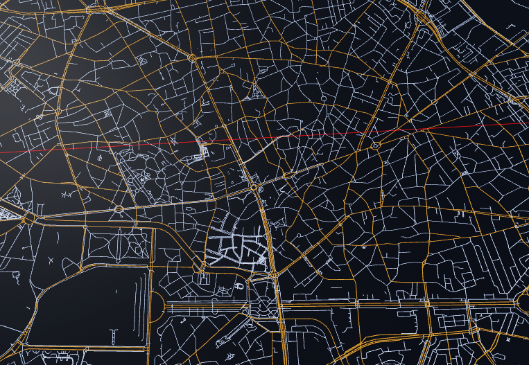

# Overpass Tilemap Engine
### (Pack geospatial data into optimized binary files via Overpass API)
### (Work In Progress)

## Libraries
libcurl - for requesting data from a local docker-hosted instance of Overpass API

json (by nlohmann) - for parsing the output from OverpassAPI

proj - for cartographic projections (For Romania - WGS84 to Stereo70)

## Features (as of yet)
### Spatial Chunking Engine
Organizing roads in a quadtree-like structure, allowing fast streaming of geographical regions in games, simulations etc.
### OverpassQL queries
Using the local endpoint for fast queries at large scale, targeting highways, streets and footways
### LZ4 Compression on binary files
Using LZ4 to compress road data and road-name buffers even more, achieving about 30-50% reduction in file size
### Terrain queries for map elevation
Using OpenTopoData API locally using Docker to get elevation data

## Setup

### Docker
To create a clone of the OverpassAPI locally, scoped down to a specific region, you first need to
download a .pbf file from Geofabrik (https://download.geofabrik.de/)

Next, convert the downloaded .pbf file into a .bz2 file and rename as "planet.osm.bz2"

Example:
```
osmium cat romania-latest.osm.pbf -o planet.osm.bz2
```

Then create a directory where the database will be stored and run the following docker command:

```
docker run -d \
  --name your_overpass_instance_name \
  --restart always \
  -p 12345:80 \
  -v "/path/to/directory/db:/db" \
  wiktorn/overpass-api
```

After the command finished, check it was created and the ngnix deamon started, ready to query
```
docker logs -f your_overpass_instance_name
```

### Create the OpenTopoData API container

Clone the opentopodata repository and run make to automatically create the container
```
git clone https://github.com/ajnisbet/opentopodata.git
cd opentopodata
make build && make run
```
To test it works, you can test queries at v1/test-dataset
```
curl https://localhost:5000/v1/test-dataset?locations=56.35,123.90
```
To get real elevation data, download a GeoTIFF file of your selected latitude & longitude bounding box,
from https://portal.opentopography.org/

In this project, SRTM30m is used, for Romania. You need to create a config.yaml file in the container that points to your file
```

# 400 error will be thrown above this limit.
max_locations_per_request: 512

access_control_allow_origin: "*"

datasets:

# Romania topography dataset
- name: ro_srtm30m
  path: data/RO_SRTMGL1/

# Example config for 90 metre SRTM.
# - name: srtm90m
#   path: data/srtm-90m-nasa-v3.0/
#   filename_epsg: 4326  # This is the default value.
#   filename_tile_size: 1  # This is the default value.

```

Now rebuild the docker container, you might need to run ```docker ps``` and ```docker stop [your_container_id]```
and then ```make build && make run```

### Build process

Simply run the CMakelists.txt file with vcpkg toolchain
```
cmake -B build -S . -DCMAKE_TOOLCHAIN_FILE="path/to/vcpkg.cmake"
cmake --build build
```

(Testing on Linux and MacOS for compatibility soon)

### Rendering

Working on a fast renderer directly in the C++ application, using OpenGL

Example render using luau scripts (read from file)


Binary files for the region can be found at https://github.com/AndreiCd27/OverpassTilemapEngine/app_output/sample_bucharest_ilfov_region
	- 3268 KB for Bucharest-Ilfov vector data
	- 130 KB for Road Name Buffer